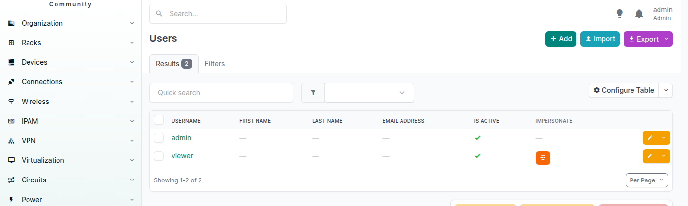
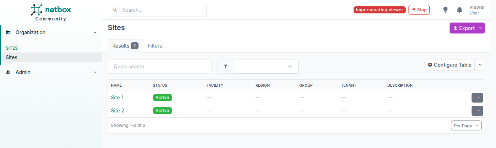

# NetBox Impersonate Plugin

Browse NetBox as another user.

## Features

- A superuser can impersonate any active, non-superuser user from the user page or
  from the Impersonate column of the user list.
- The UI, and the REST API and GraphQL used from the same browser session, then see
  the impersonated user and its RBAC. Requests authenticated with a token are not
  affected.
- A banner in the top bar shows who is being impersonated, with a Stop button.
- Superusers and inactive users cannot be impersonated, and neither can oneself.
- Every session is recorded with start and end time in the `ImpersonationLog` table.

Impersonation is provided by
[django-impersonate](https://pypi.org/project/django-impersonate/). The plugin sets the
`IMPERSONATE` Django setting itself, so any value given elsewhere is ignored.

Changes made while impersonating are recorded in the changelog as the impersonated
user.

## Screenshots

The Impersonate column in the user list:



Browsing as `viewer`, who may only view Site 1 and Site 2 out of four sites:



## Compatibility

| NetBox Version | Plugin Version |
|----------------|----------------|
|     4.7.x      |      1.0.0     |

The full matrix is in [COMPATIBILITY.md](COMPATIBILITY.md).

## Installing

For adding to a NetBox Docker setup see [the general instructions for using
netbox-docker with
plugins](https://github.com/netbox-community/netbox-docker/wiki/Using-Netbox-Plugins).

While this is still in development and not yet on pypi you can install with pip:

```bash
pip install git+https://github.com/ConsortiumGARR/netbox-impersonate-plugin
```

or by adding to your `local_requirements.txt` or `plugin_requirements.txt` (netbox-docker):

```bash
git+https://github.com/ConsortiumGARR/netbox-impersonate-plugin
```

Enable the plugin in `/opt/netbox/netbox/netbox/configuration.py`, or if you use
 netbox-docker, your `/configuration/plugins.py` file:

```python
PLUGINS = [
    'netbox_impersonate_plugin'
]

PLUGINS_CONFIG = {
    "netbox_impersonate_plugin": {},
}
```

After installing, run `manage.py migrate` to create the `ImpersonationLog` table.

## Configuration

No configuration is needed.

## Usage

As a superuser, click **Impersonate** on a user page or in the user list. Click
**Stop** in the top bar to go back.

## Contributing

Code is formatted with [Black](https://black.readthedocs.io/) and linted with
[Ruff](https://docs.astral.sh/ruff/). Both run as [pre-commit](https://pre-commit.com/)
hooks, set up once per clone:

```bash
uv sync
uv run pre-commit install
```

From then on every `git commit` checks the staged files. To check the whole repo:

```bash
uv run pre-commit run --all-files
```

Running the tests and releasing are described in [CONTRIBUTING.md](CONTRIBUTING.md).

## License

Copyright (C) 2026  GARR

This program is free software: you can redistribute it and/or modify it under the
terms of the GNU General Public License version 3, as published by the Free Software
Foundation. See [LICENSE](LICENSE).

## Credits

Impersonation is done by
[django-impersonate](https://pypi.org/project/django-impersonate/). The project was
created from the
[`netbox-community/cookiecutter-netbox-plugin`](https://github.com/netbox-community/cookiecutter-netbox-plugin)
template.
